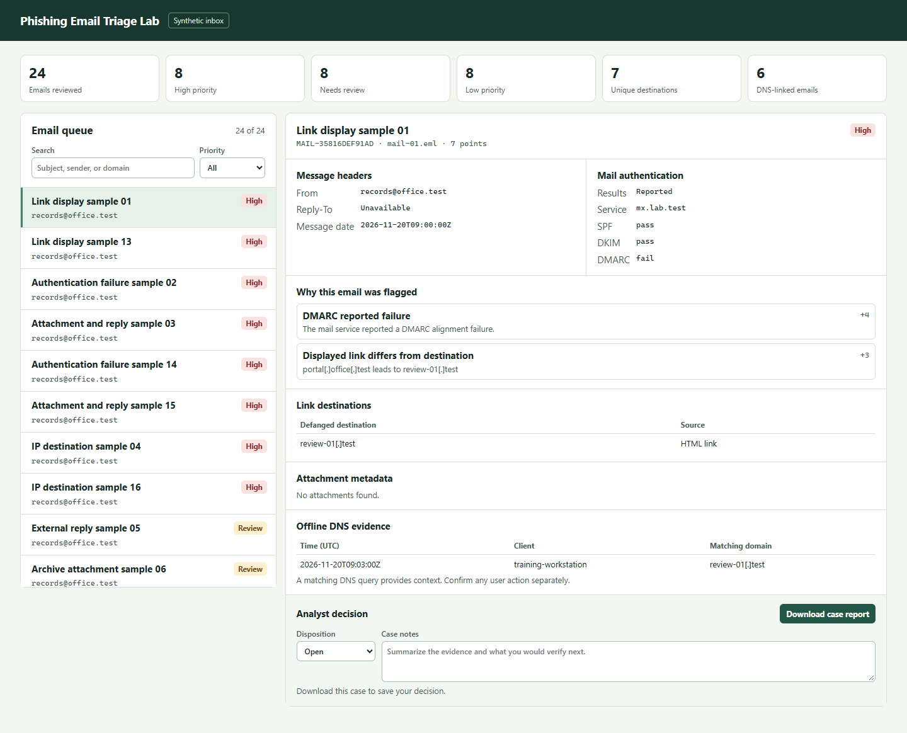

# Phishing Email Triage Lab

Investigate saved email files, prioritize suspicious messages, and export a case report with the evidence behind your decision. The lab runs offline with Python's standard library and a standalone HTML dashboard.



## Run the demo

From this directory, run with Python 3.10 or newer.

```powershell
python triage.py demo
Start-Process .\output\dashboard.html
```

The demo reviews **24 synthetic emails**. It assigns eight High, eight Review, and eight Low priorities. It extracts **seven unique link destinations** and finds matching offline DNS observations for **six emails**. These are results on deliberately labeled training examples. The fixtures use reserved test domains and inert attachment markers. [RFC 2606](https://www.rfc-editor.org/info/rfc2606/)

| Output | Contents |
| --- | --- |
| `output/dashboard.html` | Searchable email queue, evidence, and case report download |
| `output/analysis.json` | Full report with priorities, evidence, and DNS matches |
| `output/indicators.csv` | Deduplicated, defanged destinations and associated case IDs |
| `output/fixtures/` | Saved training emails and offline DNS observations |

## Investigate a sample

1. Search for **Link display sample 01**. The message received seven points for a reported DMARC failure and a displayed link domain that differs from its destination.
2. Compare the displayed and actual domains. The report shows the destination in defanged form, such as `review-01[.]test`, so it can be read as text.
3. Review the offline DNS observation at **09:03 UTC**. The domain was queried three minutes after the message timestamp. Verify any user action separately using trusted endpoint or proxy logs.
4. Choose **Investigate**, write a short assessment, and download the case report. Case notes stay in the page until you download them.
5. Compare **Routine HTML sample 10**. It has a matching DNS observation and a Low priority. DNS matches provide context and contribute zero points.

## Analyze saved email

Pass a single `.eml` file or a directory of files. The tool indexes each unique message by its content hash and accepts up to 10 MiB per file.

```powershell
python triage.py analyze .\saved-mail --out .\output\review
```

For exports from a mail system whose trust boundary preserves only its own authentication headers, supply its service identifier. Each optional DNS CSV record needs a `timestamp` with offset, a `client`, and a `domain`.

```powershell
python triage.py analyze .\saved-mail --trusted-authserv-id mx.lab.test --dns .\dns.csv --out .\output\review
```

```csv
timestamp,client,domain
2026-11-20T09:03:00+00:00,training-workstation,review-01.test
```

The tool reads recorded SPF, DKIM, and DMARC outcomes for an explicitly configured service. The sender or an email intermediary can supply header fields, so a matching service identifier depends on the collection process for trust. Multiple matching headers receive an Ambiguous status. [Authentication-Results trust boundaries](https://www.rfc-editor.org/rfc/rfc8601.html)

## How the priority is assigned

| Evidence | Points |
| --- | ---: |
| DMARC failure | 4 |
| SPF failure or softfail, without a DMARC pass | 2 |
| DKIM failure, without a DMARC pass | 1 |
| Unavailable, ambiguous, or inconclusive authentication | 2 |
| Missing or ambiguous From address | 2 |
| Different From and Reply-To domains | 2 |
| Displayed link host differs from its destination | 3 |
| Link destination is an IP address | 2 |
| Executable or script filename extension | 4 |
| Archive or disk image filename extension | 2 |

Scores of five or more are **High**, scores of two through four are **Review**, and scores of zero or one are **Low**. Each rule adds points once per message. A reported DMARC pass can come from either aligned SPF or aligned DKIM, so the score treats that result as sufficient for the authentication checks. [DMARC standard](https://www.rfc-editor.org/rfc/rfc9989.html)

The parser collects hosts from HTTP and HTTPS links in plain text and HTML anchors, normalizes and deduplicates them, and exports domain indicators. Attachments contribute filename and MIME metadata. DNS correlation matches the exact normalized host between the message Date header and 30 minutes after it. The sender can set that timestamp, so verify timing with trusted receipt logs during a real investigation.

## Tests

```powershell
python -m unittest -v
```

The suite covers the labeled fixture inbox, authentication trust, URL normalization, attached mail, DNS time boundaries, duplicate messages, and report generation.
